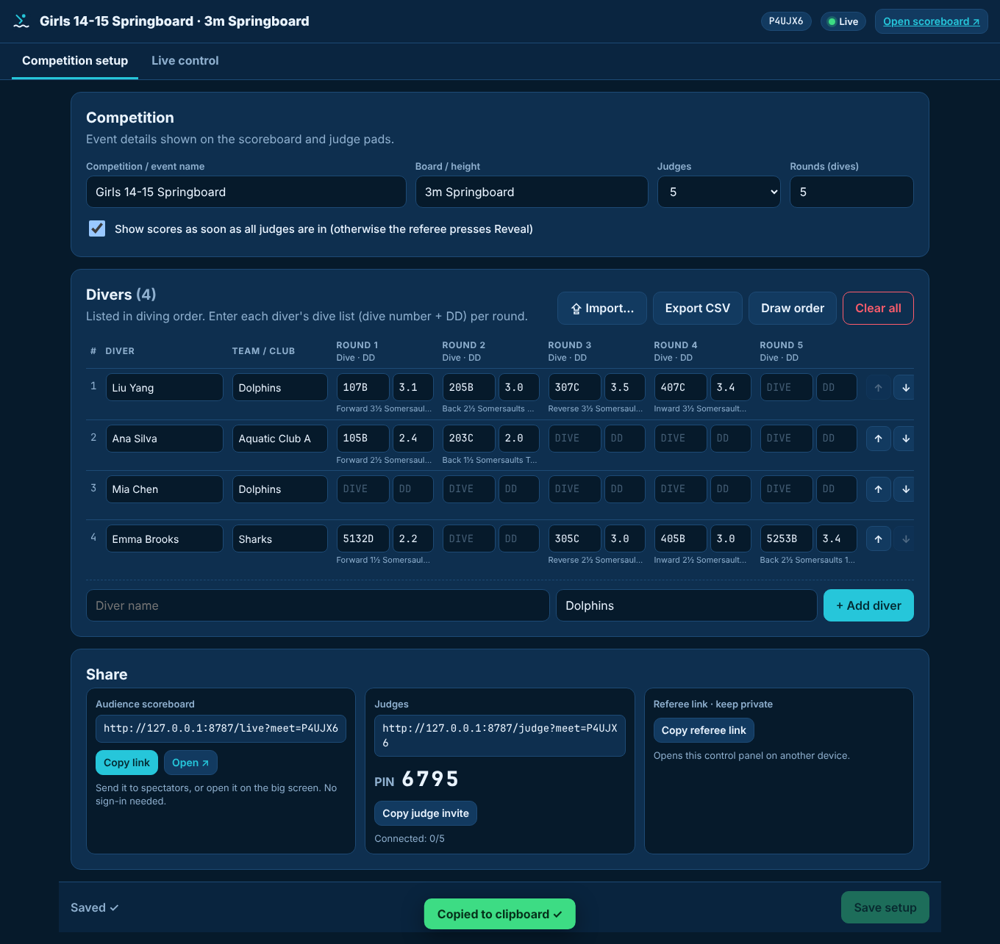
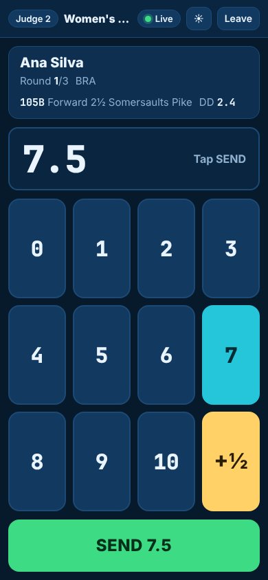
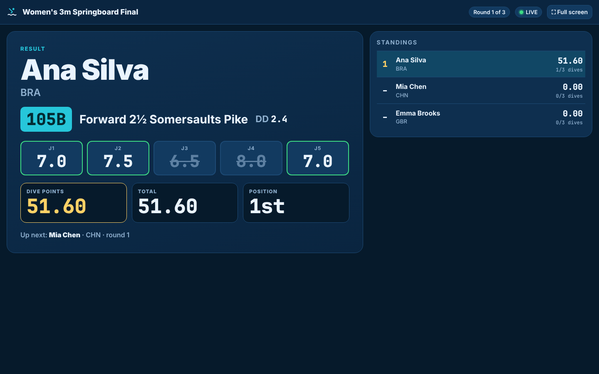
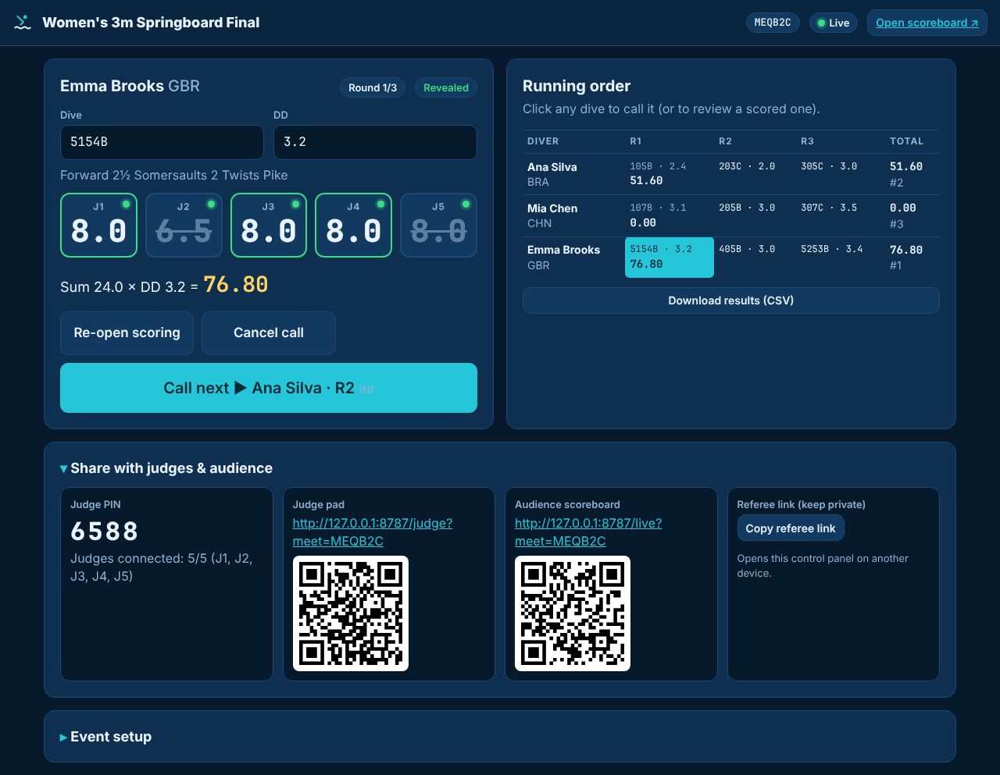

# Pool Diving Scorer

Real-time scoring for springboard and platform diving, running on **Cloudflare Workers + Durable Objects**.

| Competition setup | Judge pad | Audience scoreboard | Live control |
|---|---|---|---|
|  |  |  |  |

## Views

| URL | Who | What |
|---|---|---|
| `/` | everyone | Join as judge, open the scoreboard, or create a meet |
| `/judge?meet=CODE` | judges | Big keypad: **tap the score → (optional +½) → SEND**. Works on phones and tablets (portrait or landscape) and with a keyboard (`7` `.` `Enter`; `1` `0` for 10). Can change the score until it is revealed. Keeps the screen awake, vibrates on new dive, queues the score if Wi-Fi drops and re-sends on reconnect. Light high-contrast mode (☀︎) for outdoor pools. |
| `/live?meet=CODE` | audience / big screen | Current diver, dive number + description, DD, judge-by-judge "in" ticks, then animated score reveal (dropped scores struck through), dive points, total, position, live standings. Full-screen button for projectors. |
| `/referee?meet=CODE` | admin / referee | Two tabs. **Competition setup**: event details, judges, rounds, and the diver list. Add, edit, reorder, draw or remove divers; import them from CSV or a spreadsheet paste; export them to CSV. Also has share links for the audience, judges and referee. **Live control**: call divers, edit the dive or DD, see every judge's score and connection, override a score, reveal, mark a failed dive, re-open, running-order grid, results CSV. |

## Scoring rules (World Aquatics, individual events)

* Scores 0–10 in half points.
* **3 judges**: all three count. **5 judges**: highest and lowest dropped. **7 judges**: two highest and two lowest dropped.
* Remaining three scores summed × DD. Integer maths, so no floating-point rounding errors.
* Equal totals share a rank.

Synchronised diving panels (9/11 judges) are not supported.

## Running a meet

1. On `/`, choose **Run a meet**. Enter the competition name, board or height, number of judges and rounds, then press **Create competition**.
2. On the **Competition setup** tab, add the divers. Either:
   * **Add by hand**: type a name and team, then press Enter. Enter each round's dive number and DD in the table. Invalid dive numbers are shown in red, and the dive description is shown under each code.
   * **Import**: upload a CSV, or copy the rows from Excel or Google Sheets and paste them. A preview shows warnings before you import, and you can add the rows to the list or replace it. Accepted layouts, with an optional header row:
     ```
     Name, Team, Dive 1, DD 1, Dive 2, DD 2, …
     Ana Silva, BRA, 105B, 2.4, 203C, 2.0
     Mia Chen, CHN, 107B 3.1, 205B 3.0          ← code + DD in one cell also works
     ```
     With a header row, columns are matched by name, so an empty round stays empty. Use **Download a template** in the import dialog to get a starting file. **Export CSV** produces the same format, so you can edit the list in a spreadsheet and import it again.
   * Use the ↑ ↓ buttons or **Draw order** (random draw) to set the diving order, then press **Save setup**. Divers keep their scores when you rename or reorder them. A replace-import also keeps scores for divers with the same name.
3. **Share**: **Copy link** or **Share…** sends the audience scoreboard (no sign-in needed). **Copy judge invite** copies the judge link with the PIN.
4. Switch to **Live control** and press **Call next** (or `N`). Judge pads unlock. When every judge has sent a score, the result appears automatically, or press **Reveal** (`R`) if auto-reveal is turned off in setup.

The referee key is saved in the browser that created the meet. Use **Copy referee link** to open the control panel on another device. Meet data is deleted automatically 90 days after creation, so download the results CSV if you want to keep them.

## Develop

```bash
npm install
npm run dev      # http://localhost:8787
npm test         # scoring-rule unit tests
```

## Deploy to Cloudflare

Requires a Cloudflare account. The Workers **Free** plan works because the meet uses a SQLite-backed Durable Object.

```bash
npx wrangler login
npm run deploy
```

Wrangler prints the URL, e.g. `https://pool-diving-scorer.<your-subdomain>.workers.dev`. To use your own domain, add a route or custom domain in the Cloudflare dashboard under **Workers & Pages → pool-diving-scorer → Settings → Domains & Routes**.

For CI, set the `CLOUDFLARE_API_TOKEN` (with "Edit Cloudflare Workers" permissions) and `CLOUDFLARE_ACCOUNT_ID` environment variables, then run `npm run deploy`.

## Architecture

```
browser ──HTTP──▶ Worker (src/index.js) ──▶ static assets (public/)
        ──WS────▶ Worker ──▶ Durable Object "Meet" (src/meet.js), one per meet code
```

* Each meet is a single Durable Object. It is the only source of truth, so concurrent judge submissions are applied in order with no races. State is kept in Durable Object storage.
* Every client keeps a WebSocket open, using the hibernation API so idle connections cost nothing. The object sends each role its own view:
  * the **audience** sees only *which* judges have scored until the dive is revealed;
  * a **judge** sees their own score;
  * the **referee** sees everything.
* Judges authenticate with the 4-digit meet PIN and the referee with a random 24-character key.
* `public/importer.js` holds the CSV/spreadsheet import parser, unit-tested in `test/`.
* `src/scoring.js` holds the pure scoring rules, unit-tested in `test/`.

## License

[MIT](LICENSE). Contributions welcome!
