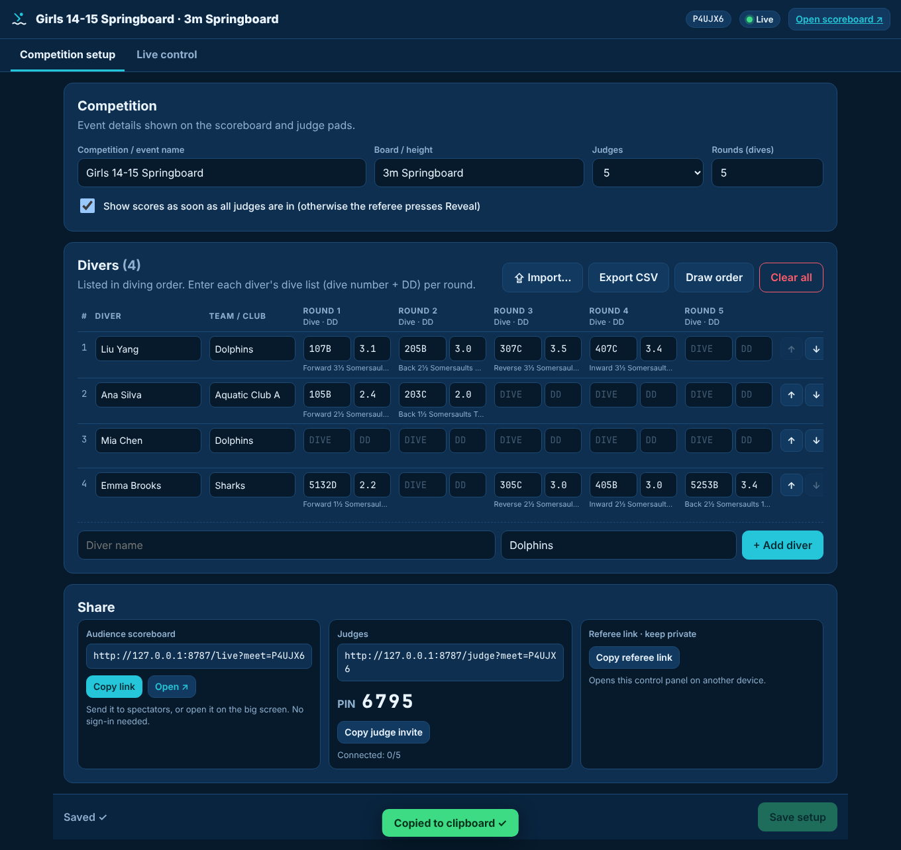
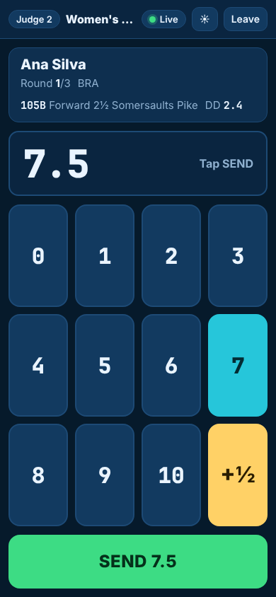
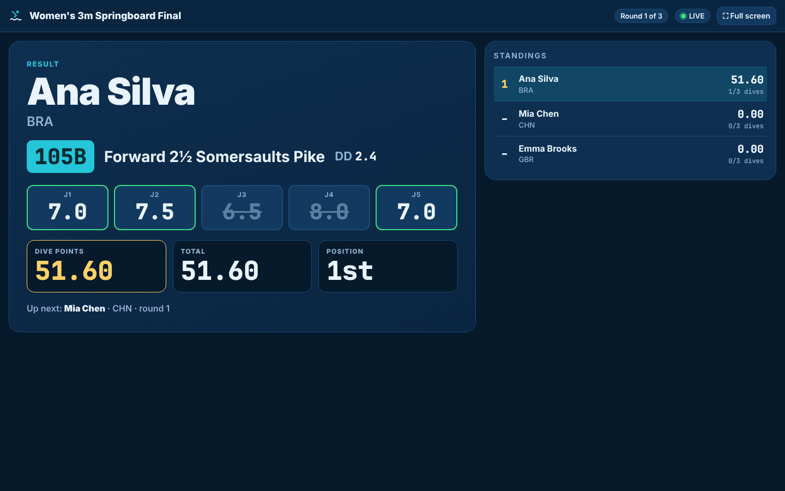
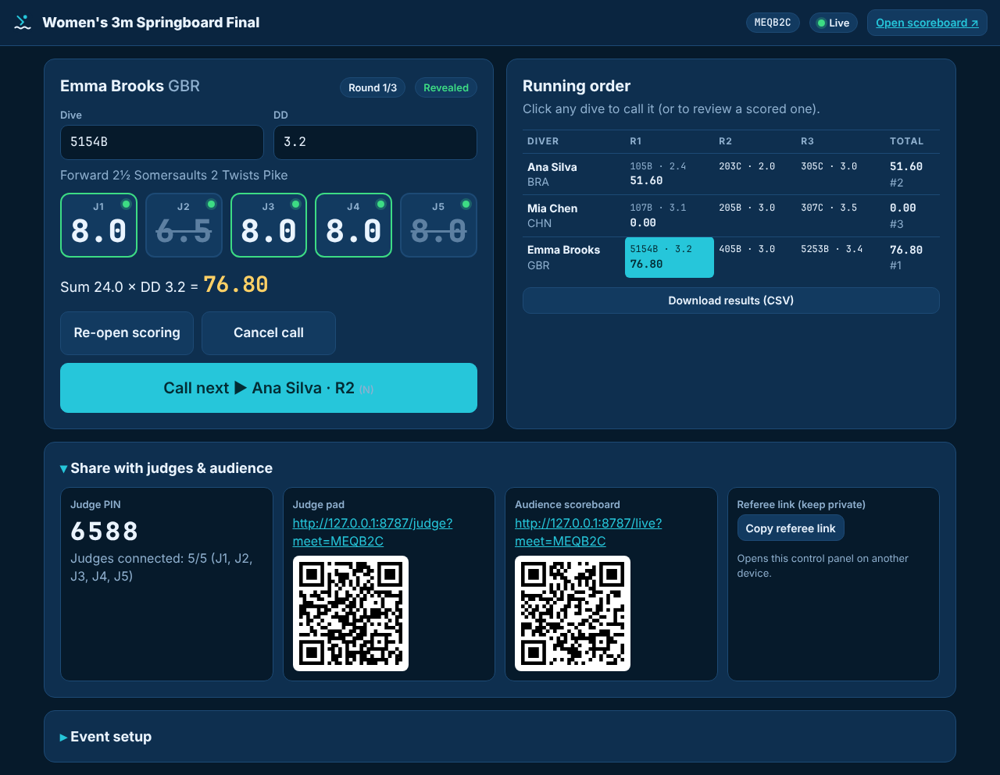

# Pool Diving Scorer

Real-time scoring for springboard and platform diving, running on **Cloudflare Workers + Durable Objects**.

| Competition setup | Judge pad | Audience scoreboard | Live control |
|---|---|---|---|
|  |  |  |  |

## Views

| URL | Who | What |
|---|---|---|
| `/` | everyone | Join as judge, open the scoreboard, or create a meet |
| `/judge?meet=CODE` | judges | Big keypad: **tap the score → (optional +½) → SEND**. Works on phones and tablets (portrait or landscape) and with a keyboard (`7` `.` `Enter`; `1` `0` for 10). Can change the score until it is revealed. Keeps the screen awake, vibrates on new dive, keeps an unconfirmed score through Wi-Fi drops and page reloads and re-sends it until the server confirms it (see *Poolside Wi-Fi* below). Light high-contrast mode (☀︎) for outdoor pools. |
| `/live?meet=CODE` | audience / big screen | Current diver, dive number + description, DD, judge-by-judge "in" ticks, then animated score reveal (dropped scores struck through), dive points, total, position, live standings. Full-screen button for projectors. |
| `/referee?meet=CODE` | admin / referee | Two tabs. **Competition setup**: event details, judges, rounds, and the diver list. Add, edit, reorder, draw or remove divers; import them from CSV or a spreadsheet paste; export them to CSV. Also has share links for the audience, judges and referee. **Live control**: call divers, edit the dive or DD, see every judge's score and connection, override a score, reveal, mark a failed dive, re-open, running-order grid, results download as CSV or Excel (`.xlsx`). |

## Scoring rules (World Aquatics, individual events)

* Scores 0–10 in half points.
* **3 judges**: all three count. **5 judges**: highest and lowest dropped. **7 judges**: two highest and two lowest dropped.
* Remaining three scores summed × DD. Integer maths, so no floating-point rounding errors.
* Equal totals share a rank.

Synchronised diving panels (9/11 judges) are not supported.

## Running a meet

1. On `/`, choose **Run a meet**. Enter the competition name, board or height, number of judges and rounds, then press **Create competition**.
2. On the **Competition setup** tab, add the divers. Either:
   * **Add by hand**: type a name and team, then press Enter. Enter each round's dive number and DD in the table. Invalid dive numbers are shown in red, and the dive description is shown under each code.
   * **Import**: upload a CSV, or copy the rows from Excel or Google Sheets and paste them. A preview shows warnings before you import, and you can add the rows to the list or replace it. Accepted layouts, with an optional header row:
     ```
     Name, Team, Dive 1, DD 1, Dive 2, DD 2, …
     Ana Silva, BRA, 105B, 2.4, 203C, 2.0
     Mia Chen, CHN, 107B 3.1, 205B 3.0          ← code + DD in one cell also works
     ```
     With a header row, columns are matched by name, so an empty round stays empty. Use **Download a template** in the import dialog to get a starting file. **Export CSV** produces the same format, so you can edit the list in a spreadsheet and import it again.
   * Use the ↑ ↓ buttons or **Draw order** (random draw) to set the diving order, then press **Save setup**. Divers keep their scores when you rename or reorder them. A replace-import also keeps scores for divers with the same name.
3. **Share**: **Copy link** or **Share…** sends the audience scoreboard (no sign-in needed). **Copy judge invite** copies the judge link with the PIN.
4. Switch to **Live control** and press **Call next** (or `N`). Judge pads unlock. When every judge has sent a score, the result appears automatically, or press **Reveal** (`R`) if auto-reveal is turned off in setup.

The referee key is saved in the browser that created the meet. Use **Copy referee link** to open the control panel on another device. Meet data is deleted automatically 90 days after creation, so download the results (CSV or Excel) if you want to keep them.

**Download results (Excel)** on the Live control tab saves a real `.xlsx` workbook with sheets for **Standings** (rank, points per round, total), one sheet per **Round**, **All dives** (the same columns as the CSV) and **Divers** (the diver list, in the import/export format). Scores, DD and points are stored as numbers, so totals and formulas work straight away in Excel, Numbers, LibreOffice or Google Sheets (File → Import).

## Competitions with groups and platforms

For a competition where several groups of divers rotate across boards and platforms, choose **Set up competition** on `/`. The setup page (`/competition?c=CODE`) has three steps:

1. **Platforms and boards**: tap `+ 1m`, `+ 3m`, `+ 5m`, `+ 7.5m` or `+ 10m` for each one in use.
2. **Judges**: paste the names, one per line, or a column copied from a spreadsheet.
3. **Groups and divers**: import the diver list. A `Group` column creates the groups; an optional `Other dives` column lists the dives a diver can also do.
   ```
   Name, Team, Group, Dive 1, Dive 2, Dive 3, Dive 4, Other dives
   Ana Silva, EDC, Girls 12-13, 101B, 201C, 301C, 401C, 103C
   ```
   Then set each group's **rotation**, for example 2 dives on the 1m, then 2 on the 3m. DD fills in from the World Aquatics table for the height of each round, and changes if the rotation changes. Type a DD to override it.

**Judge panels** (`/control?c=CODE`, linked from setup): share the judge link and PIN. Each judge opens `/pad?c=CODE` (or types the code under **Judge** on `/`), enters the PIN and taps their name. Pick a judge for each seat of each platform, or press **Fill empty seats**. A judge sits in one seat at a time, so picking them on another platform moves them, and their pad follows straight away. Each platform uses as many seats as the largest panel (3, 5 or 7) of the groups that dive there. One device per judge: signing in on a new phone replaces the old one. Sign-in pauses for a minute after 10 wrong PINs, and PINs and keys are sent after connecting, never in the URL.

**Live scoring** (`/control?c=CODE`, one tab per platform):

1. On a platform's tab, pick the **group on this platform**. A group can be on one platform at a time.
2. **Call next** (`N`) calls the group's dives on that platform round by round, divers in order. DD is set for the platform's height. Click any cell in the running order to call or review that dive.
3. Judges score on their pads (only the seats the group's panel uses). Scores reveal when all are in, or with **Reveal** (`R`) if the group has auto-reveal turned off. Click a judge's tile to override a score. **Failed dive**, **Re-open scoring** and **Cancel call** work as in a single meet.
4. **Change dive** before or after the reveal; a blank DD takes the table value for the height. The judge in **seat 1** (chief judge) can also change the dive from their pad before it's revealed, choosing from the diver's declared and other dives.
5. When the group has finished on the platform, take it off and start it on its next platform. **Standings** add up each diver's dives across all platforms.

**Two ways to run it:** one head referee runs every platform from the tabs, or each platform has its own referee. On **Judge panels**, **Copy 1m link** (etc.) gives a link that controls only that platform; it can't change panels or the setup.

**Scoreboard** (`/show?c=CODE`, no sign-in; or type the code under **Watch** on `/`): every platform in use at a glance plus live standings for each group. Pick one platform (`/show?c=CODE&p=…`) for the screen by that pool, with the judges' scores flipping in on the reveal. The scoreboard never receives PINs, keys or judge names, and shows individual scores only once a dive is revealed.

**Excel** (**Excel ↓** on the control page): a workbook with a Summary (groups, panel sizes, rotations), a standings sheet per group (each dive labelled with its platform), All dives (platform, height, dive, DD, and each seat's judge name next to their score), Divers (with Other dives), and Judges (how many dives each judge scored on each platform). Download it before the competition is deleted 90 days after it was created.

The DD table in `public/ddtable.js` comes from World Aquatics Competition Regulations, Diving Rules, Appendix 9 and 11 (in force from 9 November 2024). `scripts/parse_dd_table.py` rebuilds it from a new edition.

## Develop

```bash
npm install
npm run dev      # http://localhost:8787
npm test         # scoring-rule unit tests
```

## Deploy to Cloudflare

Requires a Cloudflare account. The Workers **Free** plan works because the meet uses a SQLite-backed Durable Object.

```bash
npx wrangler login
npm run deploy
```

Wrangler prints the URL, e.g. `https://pool-diving-scorer.<your-subdomain>.workers.dev`. To use your own domain, add a route or custom domain in the Cloudflare dashboard under **Workers & Pages → pool-diving-scorer → Settings → Domains & Routes**.

For CI, set the `CLOUDFLARE_API_TOKEN` (with "Edit Cloudflare Workers" permissions) and `CLOUDFLARE_ACCOUNT_ID` environment variables, then run `npm run deploy`.

## Architecture

```
browser ──HTTP──▶ Worker (src/index.js) ──▶ static assets (public/)
        ──WS────▶ Worker ──▶ Durable Object "Meet" (src/meet.js), one per meet code
```

* Each meet is a single Durable Object. It is the only source of truth, so concurrent judge submissions are applied in order with no races. State is kept in Durable Object storage.
* Every client keeps a WebSocket open, using the hibernation API so idle connections cost nothing. The object sends each role its own view:
  * the **audience** sees only *which* judges have scored until the dive is revealed;
  * a **judge** sees their own score;
  * the **referee** sees everything.
* Judges authenticate with the 4-digit meet PIN and the referee with a random 24-character key.
* `public/importer.js` holds the CSV/spreadsheet import parser, unit-tested in `test/`.
* **Poolside Wi-Fi:** `liveSocket` in `public/common.js` retries at most 2 s apart, gives up on a connection attempt after 5 s, and treats a connection as dead if it hears nothing for 8 s (pings every 3 s), which catches phones whose Wi-Fi dropped while the socket still looks open. Any tap or key press retries straight away. Timings are tuned to feel instant rather than to save battery. A judge's score stays pending until the server acks it. With no ack within 3 s the pad re-sends it, reconnecting first if the server has gone quiet, and keeps trying until it's confirmed or the dive has moved on. Pending scores are saved in the browser, so a reload re-sends them. The decisions live in `public/outbox.js`, unit-tested in `test/`.
* `public/xlsx.js` builds the Excel download in the browser: a small dependency-free SpreadsheetML/ZIP writer plus the results workbook layout, unit-tested in `test/`.
* `src/scoring.js` holds the pure scoring rules, unit-tested in `test/`.

## License

[MIT](LICENSE). Contributions welcome!
